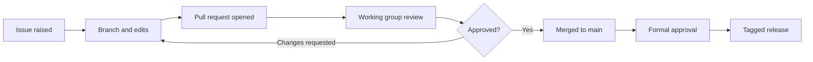

# How our process maps to GitHub

If you are used to working with documents, email, and meetings, this page shows how familiar steps translate into GitHub.

> **Note:** This page is an illustration for the sandbox. The authoritative description of how Appia approves its specifications is maintained by the Foundation. If this page differs from the official process, the official process applies.

## The flow at a glance

## Side-by-side

| What we do today | What it looks like in GitHub |
|------------------|------------------------------|
| Someone spots a problem or has an idea | They open an **issue** |
| Discussion on a mailing list or call | Comments on the **issue** or **pull request**, or a **Discussion** |
| Someone drafts new wording in their copy of the document | They make edits on a **branch** |
| Circulating a tracked-changes draft | Opening a **pull request** |
| Reading the changes | The **Files changed** tab (a diff) |
| Comments in the margin | **Review comments** on specific lines, and **suggested changes** |
| "I'm happy with this" | An **approving review** |
| "I have concerns" | **Request changes** |
| Accepting the changes into the master draft | **Merging** the pull request into `main` |
| The agreed working version | The `main` branch |
| An approved, numbered version | A **release** with a **tag**, such as `v1.0.0` |
| Document history or revision table | The **commit history** |
| "Who changed this and why?" | **Blame** view, or the commit and pull request linked to each change |
| An action log | **Issues**, **labels**, and **assignees** |
| Standing list of required approvers | **CODEOWNERS** |
| Saving a draft for later | A **draft pull request** |

## What changes, and what doesn't

**Stays the same:** people still discuss, review, and agree changes together. Approval still rests with the people and bodies who hold that responsibility.

**What GitHub adds:**

- A permanent, searchable record of every change, who made it, and the discussion behind it.
- Review that happens against the exact text, line by line, rather than in separate copies of a document.
- Protection against accidental change, because nothing reaches `main` without a pull request and approval.
- A clear, referenceable identity for each approved version.

## Worked example

1. Alex notices that a definition is unclear and opens **Issue #14**: "Clarify definition of *evidence*".
2. Sam creates the branch `sam/clarify-evidence` and edits section 3.
3. Sam opens a **pull request** that says `Closes #14` and asks Priya and Jordan to review.
4. Priya leaves a **suggested change** on one line. Sam accepts it with one click.
5. Priya and Jordan each **approve**.
6. The pull request is **merged** into `main`, and Issue #14 closes automatically.
7. When the group agrees a version is ready, a maintainer publishes **release `v0.2.0`**.
8. Months later, anyone can open the **History** or **Blame** view and see exactly why the definition reads the way it does.
