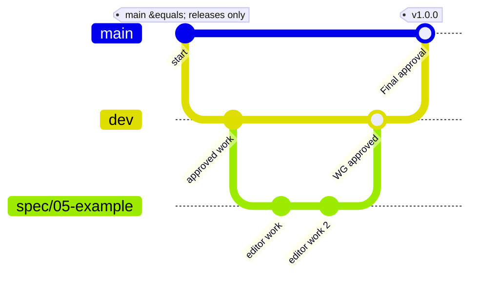

# Working in the Core Specifications repository

The exercises in this sandbox use a simple flow: branch from `main`, then merge back into `main`. The real **Core Specifications** repository has one more step, so you will not be surprised when you get there. This page shows the difference.

> **Note:** this page is an illustration. The authoritative description of the process is in the Core Specifications repository ([GOVERNANCE.md](https://github.com/appia-foundation/core-specifications)), which is private to Working Group participants. If this page differs from it, that repository applies.

## The branches

| Branch | What it is | Who changes it |
|---|---|---|
| `main` | The **publication** branch. Only approved releases are merged here. | WG chairs only |
| `dev` | **Staging.** Holds only what the Working Group has approved. | WG chairs only, after WG approval |
| `spec/NN-name` | One working branch per specification. | That spec's editors |

## What is different from the sandbox exercises

| In the sandbox | In the Core Specifications repository |
|---|---|
| Branch from `main` | Editors work on their spec's branch; everyone else raises issues |
| Pull request into `main` | Pull request from the spec branch into **`dev`** |
| A maintainer merges | A WG **chair** merges, after the Working Group approves |
| `main` is the working version | `main` only changes at a Final Approval, tagged `v1.0.0` |

## Practise the real flow

This sandbox has a `dev` branch for the purpose. See exercises 6 and 7 in the [README](../README.md#try-it-yourself-suggested-exercises).
